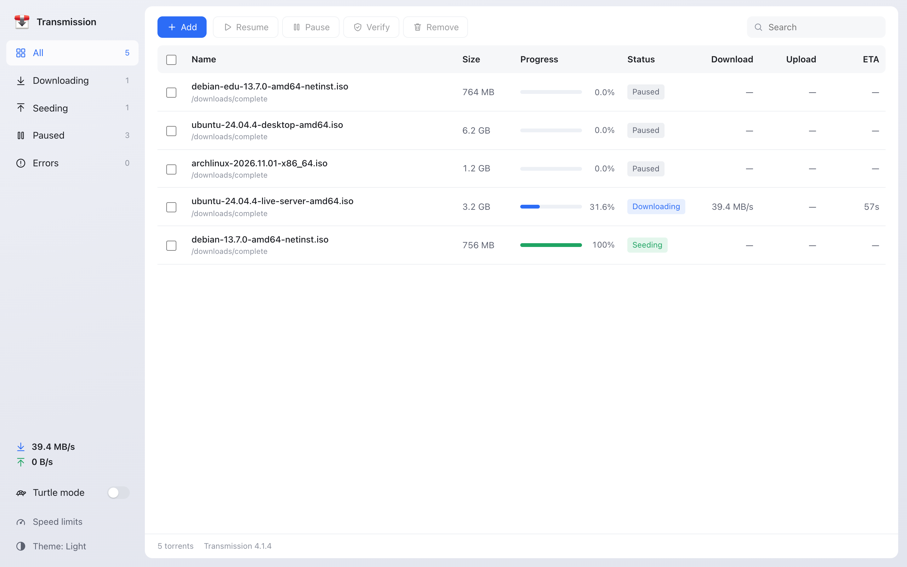
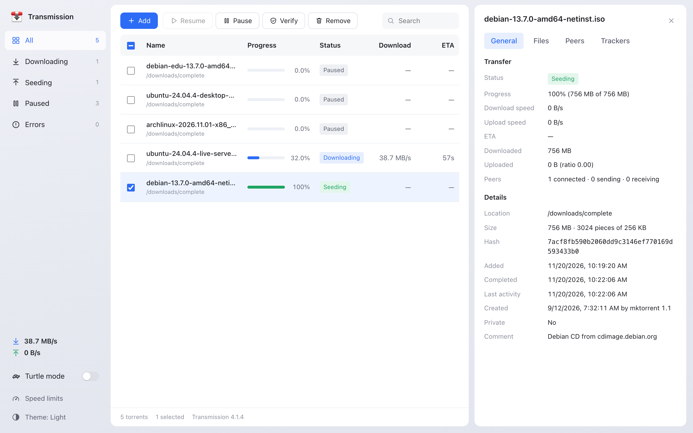
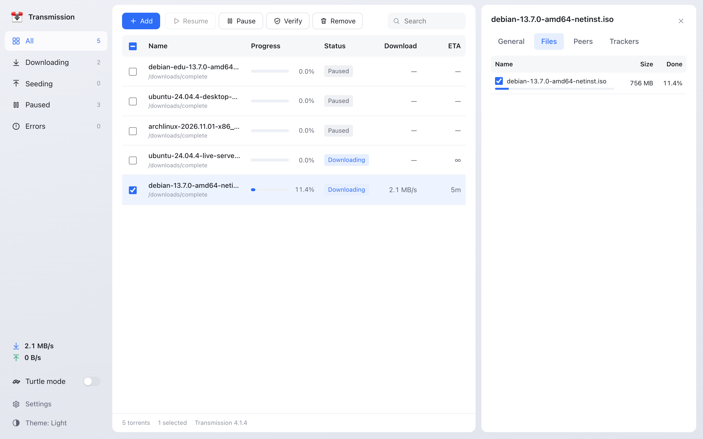
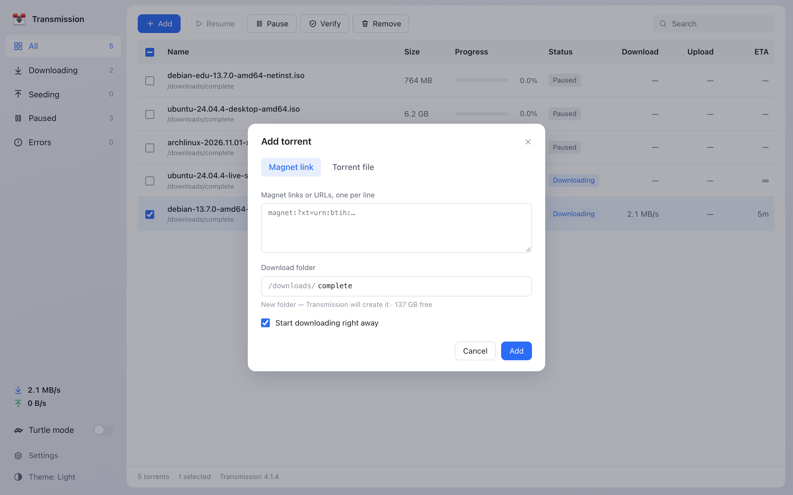
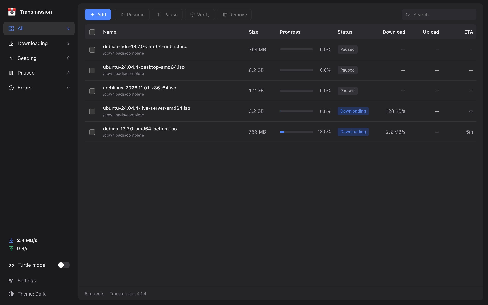
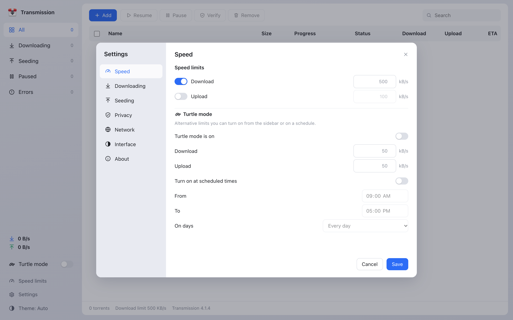

# Transmission for UGOS Pro

[Transmission](https://transmissionbt.com/) packaged as a Docker app for UGREEN NAS devices running **UGOS Pro**, with a web UI redesigned to look like a native UGOS app.

> Unofficial community package. Not affiliated with the Transmission project or UGREEN.



| | |
|---|---|
|  |  |
|  |  |
|  | |

## Features

- **Transmission 4.1.4** from the [linuxserver.io image](https://github.com/linuxserver/docker-transmission), wrapped for UGOS Pro (amd64)
- **UGOS-style web UI**: sidebar filters, sortable list, detail panel (general, files, peers, trackers), add by magnet link or `.torrent` file (drag and drop anywhere), light and dark themes, phone layout
- **Settings** matching the desktop app's preferences: speed limits and turtle-mode schedule, download queue, incomplete folder, seeding limits, encryption, blocklist, peer limits, µTP/PEX/DHT/LPD, default trackers, port test
- **Live speeds in the browser tab title** (optional)
- **No permission questions at install**: the container finds a user that can actually write to the download folder you pick, and never changes your share's ownership

## Install

1. Download the latest `.upk` from [Releases](../../releases).
2. In UGOS Pro, open **App Center › Manual Install** and choose the file. Your NAS must be authorized for developer packages.
3. Pick the **download folder**. Choose a web UI username and password (both required).
4. Open the app from the desktop, or go to `http://<nas-ip>:9091`.

Updates install the same way. A higher build number upgrades in place and keeps your torrents and settings.

> **Upgrading from build 10 or earlier:** the app ID changed from `com.davidsanchez.transmission` to `me.davidsanchez.transmission` in build 11, so UGOS sees it as a new app. Uninstall the old one, then install the new one and pick the same download folder. Downloaded files stay on your share; the torrent list and settings start fresh.

| Port | Use |
|---|---|
| 9091/tcp | Web UI and RPC (served by a small nginx in front of Transmission, which listens on 9092 inside the container only) |
| 51413/tcp+udp | Incoming peers: forward it on your router for faster downloads |

### Which user Transmission runs as

UGOS shares often have a root-owned top folder with ACLs, so at startup the container tests write access and picks the first user that works:

1. the folder's owner, if it isn't root
2. the owners of what's already inside (for example another download client's user)
3. `1000:100`

The choice is logged as `[ug-entrypoint] … writable as UID:GID`. Files are created with `UMASK=002`, so other apps in the `users` group can import them.

If the download folder already has an `incomplete` folder this user can't write to (for example one left by another download client), Transmission keeps unfinished downloads in `incomplete-transmission` instead, and logs the switch. Folders are never re-owned.

### Using it with Sonarr, Radarr and similar apps

- In the *arr app's Transmission download client, leave **Directory** empty and set a **Category** (e.g. `tv-sonarr`). Downloads then go to a `<category>` subfolder of Transmission's download folder (Settings › Downloading).
- If the *arr container mounts the same share at a different path, add a **Remote Path Mapping** from `/downloads/` to that path.
- Run the *arr apps with the same `PUID`/`PGID` that Transmission picked, as shown in its log.

## Build it yourself

Requirements: Docker, and UGREEN's [`ugcli`](https://developer.ugnas.com/en/doc/tools/ugcli.html).

```bash
./scripts/build-image.sh   # builds the amd64 image and saves rootfs_amd64/images/*.tar
./scripts/pack.sh          # ugcli check + pack with the next build number (from BUILD); writes build_dir/pkgs/upk/*.upk
```

Commit `BUILD` after packing: UGOS only upgrades in place when the build number is higher.

### Automatic releases

[`.github/workflows/auto-release.yml`](.github/workflows/auto-release.yml) runs daily. When linuxserver publishes a newer stable `lscr.io/linuxserver/transmission` tag, it moves the app to it (`scripts/upstream.sh apply`), builds the image, packs the next build, commits, and publishes the `.upk` as a release. Run it manually with **force** to release wrapper changes without an upstream update. After changing the image yourself, bump the `-ugN` suffix of the wrapper tag.

| Path | What it is |
|---|---|
| `project.yaml` | UGOS app metadata and install parameters |
| `rootfs_common/docker-compose.yaml` | Compose file UGOS runs |
| `image/` | Wrapper image: `ug-entrypoint.sh` (user and folder checks), nginx front proxy, disabled share chown, web UI |
| `ui/` | The web UI (plain HTML/CSS/JS, no build step) |
| `scripts/` | Image build, packing, upstream tag updates, icon rendering |
| `docs/` | Help, support, privacy policy and license pages (GitHub Pages), screenshots |

## Credits and licenses

- [Transmission](https://github.com/transmission/transmission) is GPLv2/GPLv3. The app icon is rendered from its official SVG.
- [linuxserver/docker-transmission](https://github.com/linuxserver/docker-transmission) is GPLv3.
- Settings layout inspired by [flood-for-transmission](https://github.com/johman10/flood-for-transmission).

This package (wrapper, scripts and web UI) is licensed under the [GNU GPL v3.0](LICENSE). Made by [emulienfou](https://davidsanchez.me).
See the [privacy policy](https://emulienfou.github.io/ugos-transmission/privacy.html): the app collects no personal data.
